# Email Outreach

A self-hosted outreach app for CSV contact lists, templates, segmentation, optional lead scoring, and Gmail delivery.

**Draft → Save edits → Send to Outbox → hold/filter/group → review sender and messages → Send real emails → Sending Queue/History.** The selected-message review also offers Instant send Email, which skips holding but still requires exact-sender/message confirmation. There is no separate approval step. Adding to Outbox or creating a batch never sends email.

## See the app in action

The **Office Pantry Demo** walkthrough follows a synthetic list of 40 contacts from CSV import to personalized drafts and a held Outbox batch. Screenshots are captured at 2x resolution; click any image to open the full-size PNG.

[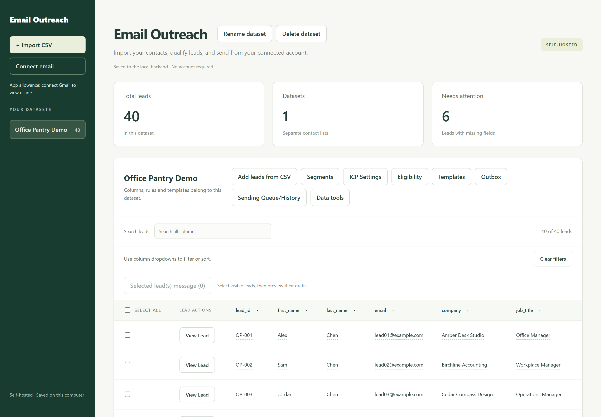](docs/screenshots/02-workspace.png)

<details>
<summary><strong>Explore the workflow: import, filter, qualify, draft and organize messages</strong></summary>

### 1. Import your contact list

Choose a CSV, name the dataset and select its recipient email column. Preview the rows before creating the dataset. This example uses the bundled [synthetic contact list](data/demo-leads.csv).

[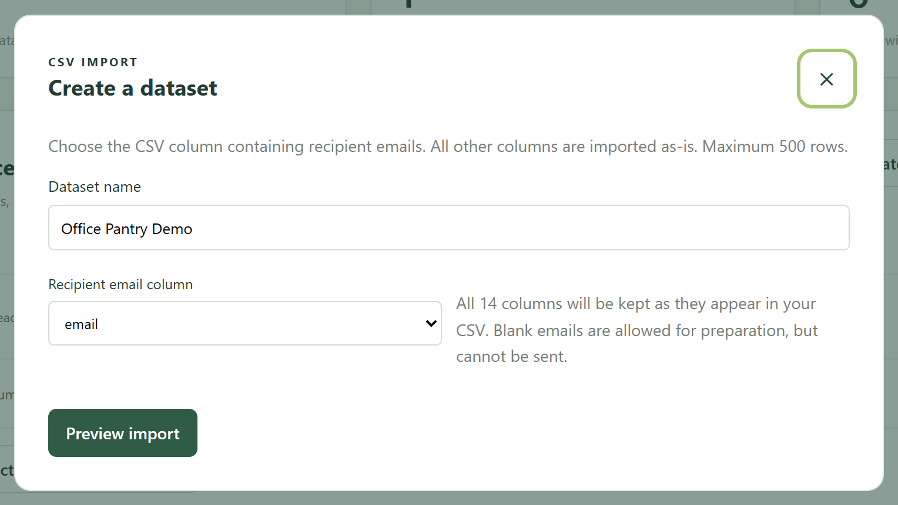](docs/screenshots/01-import.png)

### 2. Find the leads you want

Each column has its own filter and sorting controls. Here, selecting **Markham** and **Toronto** narrows the demo list to 25 of 40 leads.

[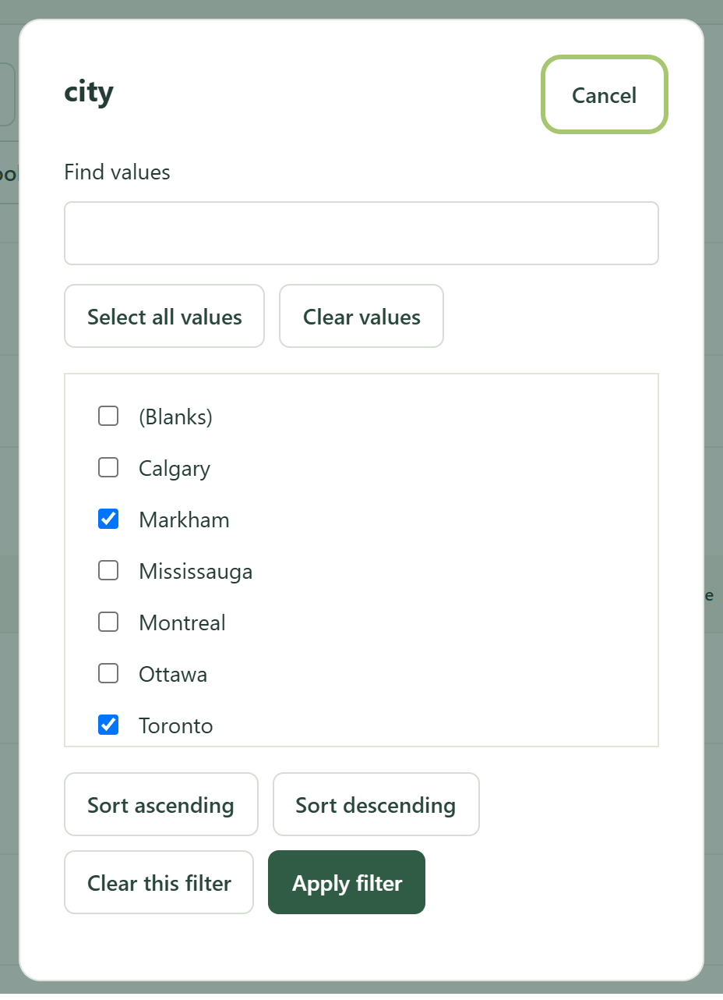](docs/screenshots/03-column-filter.png)

### 3. Group contacts into segments

Segments match conditions against your CSV columns. This example groups office operations and people/HR roles so each group can use a relevant default template. Creating a segment does not create its template automatically.

[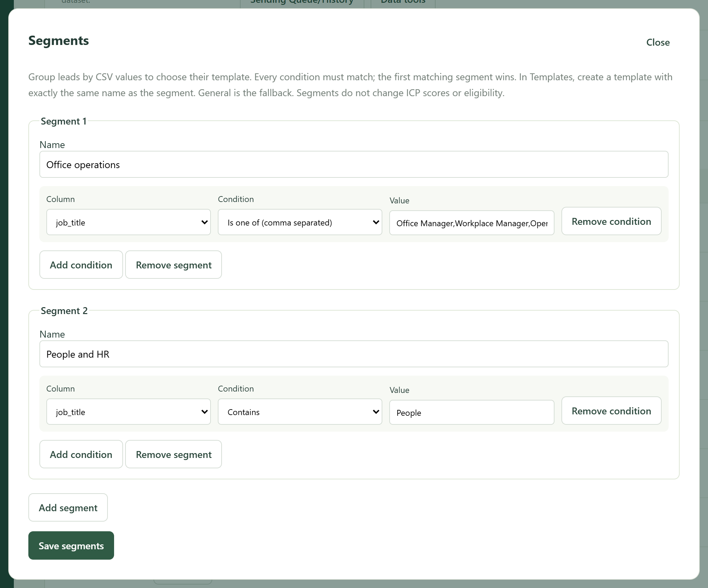](docs/screenshots/04-segments.png)

### 4. Set scoring rules and see the results

The example gives up to 50 points for office size and 50 for daily attendance. Priority thresholds translate the total into Low, Medium or High; optional eligibility requirements are managed separately.

[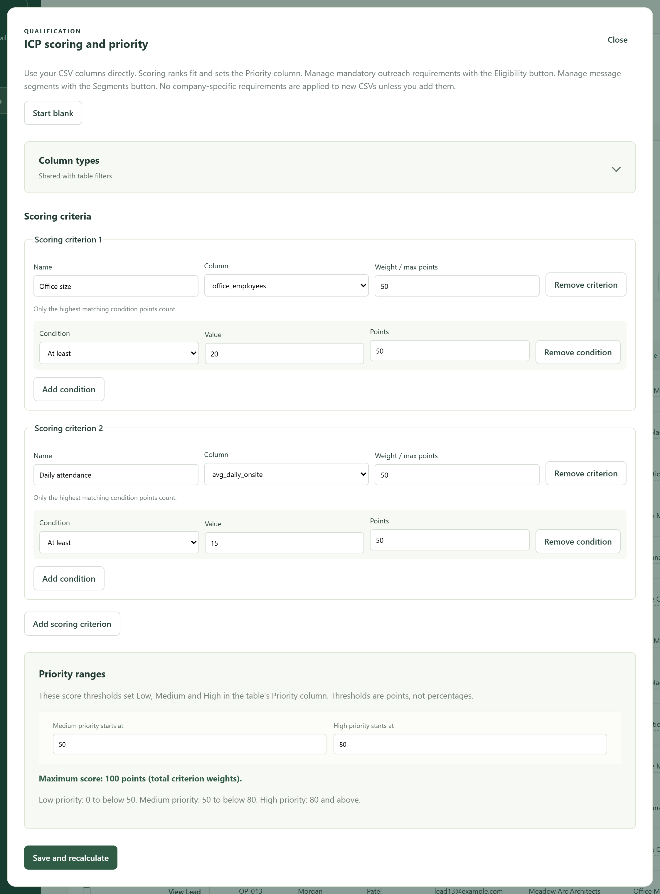](docs/screenshots/05-scoring.png)

Scroll across the table to see the calculated **Segment**, **Score**, **Priority**, **Eligibility** and outreach fields alongside your source data.

[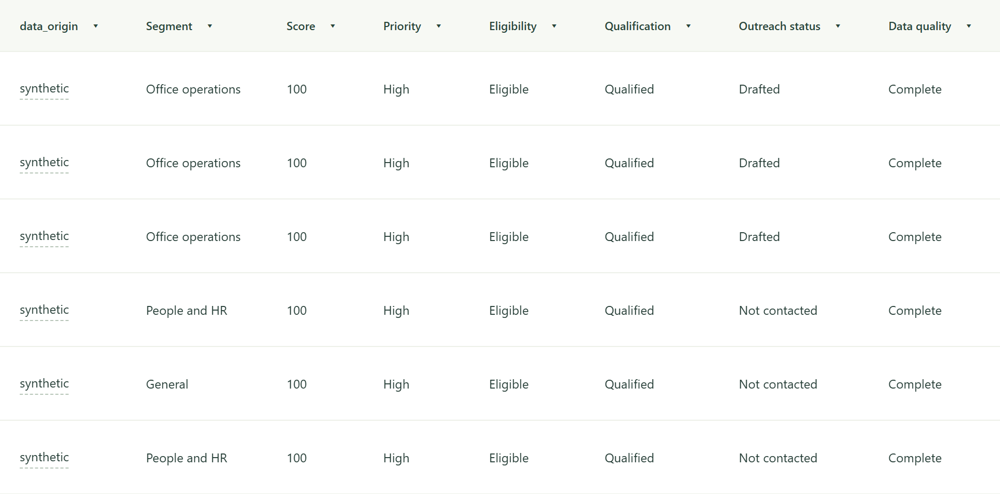](docs/screenshots/11-priority-results.png)

### 5. Write reusable templates

General is the fallback template. Add segment or custom templates and insert CSV variables to personalize the subject and message.

[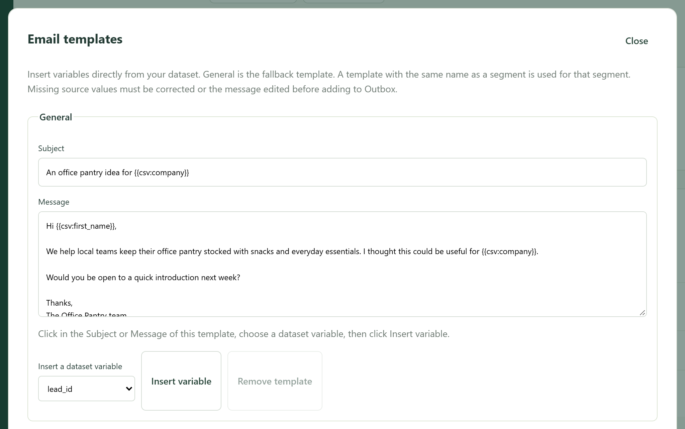](docs/screenshots/06-templates.png)

### 6. Keep multiple drafts for a lead

Review the personalized message, edit it and **Save edits**. **Create additional draft** keeps another independent draft with its own template. This lead has both an Office operations draft and a General draft.

[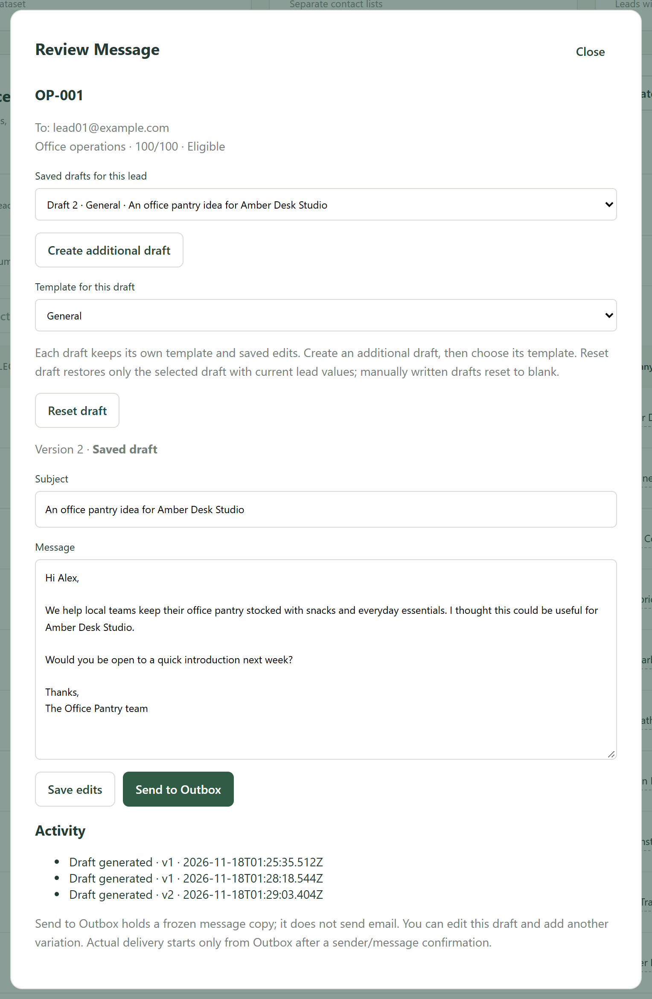](docs/screenshots/07-message-drafts.png)

### 7. Review several messages together

Select leads in the table and open **Selected lead(s) message**. Review each personalized copy, then choose **Send to outbox** to hold them. **Instant send Email** opens a separate real-send confirmation.

[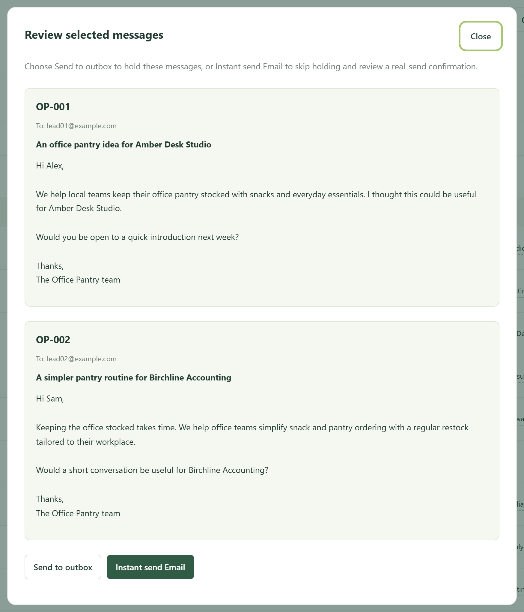](docs/screenshots/08-selected-messages.png)

### 8. Organize held messages in Outbox

Select held copies and create a named batch. Here, **Office pantry introductions** contains three messages. They remain on hold until a separate sender/message review and send confirmation.

[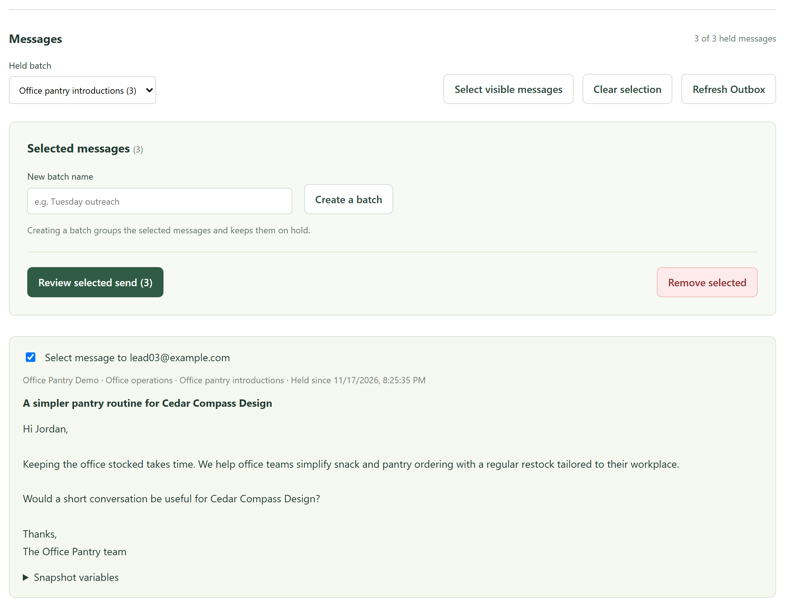](docs/screenshots/09-outbox.png)

Combine message filters with saved CSV values. This example selects the **Office operations** template and an office employee count of **at least 20**.

[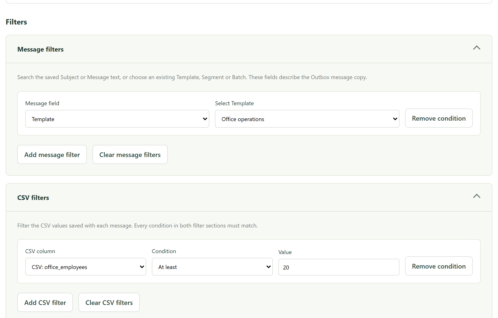](docs/screenshots/10-outbox-filters.png)

These are actual app captures from an isolated local installation using synthetic `example.com` contacts. The scoring rules, segments and template copy are illustrative configurations; importing the CSV alone does not install them. No Gmail account was connected, and no emails were queued or sent. Synthetic contacts are blocked from real delivery. After sending to real contacts, **Sending Queue/History** shows active work and recorded outcomes.

</details>

## Run locally

Requires Node.js 24+ and a modern browser. Install the pinned dependencies once inside the project:

```powershell
cd email-outreach
npm ci
npm start
```

Open http://127.0.0.1:8765/app/. The Python command below remains available as a compatibility launcher; it also requires Node and the installed dependencies.

From the `Open Source GTM` workspace root:

```powershell
python email-outreach/serve.py
```

Run the backend in a normal terminal with outbound HTTPS access. An agent sandbox, proxy or firewall can allow the browser login while blocking the backend token exchange. If an agent launches the server, its process needs network access. Keep the terminal running. Stop any older Python static server first, then restart using the new backend. Do not serve the project with a generic static server after configuring Gmail: private state lives outside the backend's public route allowlist.

Open http://127.0.0.1:8765/app/ and keep the terminal running. Ctrl+C stops the server. If you see `ERR_CONNECTION_REFUSED`, restart this command. If port 8765 is already in use, reuse the running server or stop it in its original terminal before restarting.

## First steps

1. Use sidebar **Import CSV** to create a named dataset. Select the column containing recipient email addresses; the other columns keep their exact names and values.
2. Use **Segments**, **ICP Settings**, **Eligibility**, and **Templates** as needed. Each dataset has separate settings.
3. Click **View Lead ? Review Message**. A new draft uses a same-named segment template when available, otherwise General. You can select any template for an individual lead, or Manually from scratch.
4. Edit the subject/body and **Save edits**. Use **Create additional draft** to keep another message for the same lead, then choose its template (or Manually from scratch). **Saved drafts for this lead** switches between independent saved messages; save unsaved edits before switching or creating another. **Reset draft** restores only the selected draft from its template with current lead values, or blanks a manual draft, after confirmation. Bulk lead actions and Send to Outbox use the selected draft.
5. **Send to Outbox** saves a frozen copy. Edit the working draft and add another variation if needed; each Outbox entry has its own identity. Use **Selected lead(s) message (#)** to review several leads together: **Send to outbox** saves missing drafts and holds copies; **Instant send Email** saves missing drafts and opens a final exact-sender/message confirmation, bypassing the holding phase. Closing that confirmation sends nothing.
6. Open **Outbox** for the active dataset. Messages, template/segment choices, CSV columns and held batches are scoped to that dataset; switching datasets clears filters and message selections. **Message filters** search saved Subject/Message text with conditions; Template, Segment and Batch use dropdowns of existing values with exact matching. Choices include configured templates/segments and historical values saved on held copies; No batch selects ungrouped messages. A separate **CSV filters** card lists source columns, including when Outbox is empty. Recipient and Dataset are not message-filter choices. All filters across both sections combine with AND. Subject/Message and CSV fields use the same conditions as Segments/ICP: Equals, Does not equal, Contains, Is one of, Has a value and Is blank, plus At least, At most and Between for numeric CSV fields. Contains searches text without case sensitivity; filters match the frozen Outbox copies. Select visible messages, enter a name, and **Create a batch** to group them while keeping them on hold.
7. Choose a held batch (or filters), **Select visible messages**, then **Review selected send**. Check the actual Gmail sender and every message before **Send real emails**. This final action enqueues delivery.
8. **Sending Queue/History** shows current queued/sending jobs separately from accepted, failed, unknown and cancelled outcomes. Accepted means Gmail accepted the request, not confirmed inbox delivery. **Clear history** asks for confirmation and removes the displayed completed entries from this view across datasets. It leaves active sends and Gmail emails alone. The clear persists after reload; internal delivery records stay available for sending limits, duplicate protection and lead tracking. Check Gmail Sent before clearing Unknown outcomes.

Unsaved form edits trigger the browser's standard warning before refresh (including Ctrl+R), tab close or navigation. This covers message drafts, templates, scoring/segments/eligibility, source corrections, pending imports, Data tools entries, sending pace, batch names and account configuration. Saving or cancelling clears the warning; search/filter changes do not trigger it. The browser controls the text and display of the warning and requires prior user interaction. This is a leave-page safeguard, not autosave.

## Outbox and message copies

Outbox is shared across datasets on the local backend and survives browser reloads and backend restarts. Adding messages does not require a Gmail connection; choose/connect the sender before final delivery. Each copy freezes the recipient, subject, body, lead/dataset references, template, segment and CSV variables as they existed when added. Subsequent lead/template edits do not change held or historical copies.

Multiple copies to the same recipient are allowed, in one batch or separate sends. Each copy can enqueue only once; refreshing/replaying a final send cannot enqueue it twice. An uncertain Add to Outbox response can be retried in the same page using its request ID. After an uncertain response or reload, inspect Outbox before adding again.

Batches are named groups, not scheduled sends. The batch dropdown appears only when batches contain held messages and shows message counts. With no held batches, an explanation replaces the dropdown. Instant sends bypass Outbox and do not create held batches. Select a batch to filter its held messages, select visible messages and review their send. You can remove selected held copies after confirmation; this keeps lead drafts. Once queued, a copy leaves the holding list and is tracked in Queue/History. Removing a dataset does not remove its Outbox copies or cancel queued jobs.

Old simulated-delivery records are not shown in Outbox or converted into pending real messages. Old approval metadata and legacy simulation helpers remain compatible with saved data, but their controls are retired from the app.

## CSV datasets and quick corrections

New installations start empty. Sidebar Import CSV creates a separate dataset even if headers or recipients match another dataset. **Add leads from CSV** appends to the current list: matching headers align automatically; otherwise map incoming columns to existing columns. Imports accept up to 500 rows per file and 2 MB. Blank recipients are allowed for preparation but prevent adding messages to Outbox. Invalid addresses and duplicate rows/recipients in the same list are reported.

The table shows the active dataset's source columns and separate calculated fields. Column dropdowns support value selection, blanks, sorting and numeric bounds where appropriate. Search and filters combine; Select All selects visible leads only. **Needs attention** filters missing values.

Click source values for occasional corrections with Save change/Cancel. Internal legacy IDs and calculated values remain read-only. After source changes, reset the working draft before editing/saving the refreshed message; source freshness is checked before holding a message. Already held, queued and sent snapshots remain unchanged. Newly created message workflows permit editing a previously contacted lead and preparing more messages.

**Data tools** supports confirmed row/column add/delete and two CSV exports: source data (current CSV fields) and outreach report (source plus current Segment, Score, Priority, Eligibility, Qualification, Outreach status and Data quality). Exports include all rows, regardless of filters. Source headers, leading zeros, Unicode, quotes and multiline text are preserved. Required recipient/internal columns and active rule/template references are protected. Deleting the last row retains its schema. Bulk data cleaning belongs outside this outreach app.

## Segments, scoring and eligibility

- **Segments:** optional ordered all-match groups choose the default template. The first matching group wins; unmatched leads use General. Creating a segment does not create a template.
- **ICP Settings:** assign weights and conditions against CSV columns. Only the highest matching points count per criterion. Priority ranges, directly below Add scoring criterion, explain Low/Medium/High in the table; thresholds are points, not percentages. With no criteria, leads are Unscored. Qualified means Eligible and High priority; qualification itself is not a sending gate.
- **Eligibility:** optional mandatory conditions, independent of score. Every requirement must match. Failures produce Ineligible; missing required information produces Needs data. Leaving requirements empty imposes no business restriction, while recipient/message validation still applies.

Column types are shared between rule editors and table filters. Auto treats a column as Number only when all nonblank values are finite decimal numbers without leading zeros. Mixed/empty/leading-zero columns default to Text. Expand Column types in ICP Settings for dataset-local Text/Number overrides; CSV values are never converted. Numeric conditions/bounds are hidden for Text. Existing incompatible conditions remain visible and require correction before saving that section. Points must stay within each criterion maximum, with immediate feedback. Start blank in ICP confirms, preserves eligibility/segments, and only changes the form until saved.

## Templates and manual messages

General is the universal fallback. Create a same-named segment template using **Select template type**, or create a custom named template. Any saved template is available for per-lead override regardless of segment membership. Use normal CSV variables for personalized text; mock personalization is retired.

Under each template, choose **Insert a dataset variable** after placing the cursor in that template's Subject or Message. The picker retains the last caret position or selected text. Inserting without a destination prompts you to choose one. **Reset and delete all templates** is light red and confirms before resetting the form to default General and removing other templates; Save templates commits it, Close discards it. Existing message copies remain intact.

## Connect Gmail

This local installation supports one connected Gmail sender at a time. Gmail uses sending-only permission plus verified OpenID/email identity; there is no inbox/reply reading. Outlook is not implemented yet.

1. In [Google Cloud Console](https://console.cloud.google.com/), create or choose your own project and enable **Gmail API**.
2. Configure the Google Auth Platform consent screen. For personal testing, select the external/testing audience where applicable and add your own Google account as a test user. Workspace administrators may restrict third-party access.
3. Add the `gmail.send` permission and basic OpenID/email identity permissions. The app requests sending and verified identity, without inbox reading access.
4. Create an OAuth client of type **Web application**. Add this exact authorized redirect URI: `http://127.0.0.1:8765/oauth/google/callback`. If you change the port using OFFICEPANTRY_PORT, register the matching URI.
5. Start the app, click **Connect email** below Import CSV in the sidebar, enter that client's ID and secret locally, then click **Connect Gmail**. Complete Google's consent screen. Do not put credentials in Git or send them through chat.
6. Import your contacts, compose messages, and send copies to Outbox. Start with an address you control. Final sender/message review occurs in Outbox before delivery.

Synthetic bundled contacts and example.com/org/net recipients are blocked from real delivery. Automated tests use injected mock providers, never real Gmail sends. Manual additional messages to a lead are supported; automated follow-up scheduling and reply synchronization are not implemented.

## App allowance, pace and recovery

Outbox and the sidebar show a hard **500-message app allowance per sender in a rolling 24 hours**, shared across datasets. This is not Gmail's remaining quota: mail sent elsewhere is not counted, and Google may reject earlier. Holding messages does not consume allowance. Queued messages reserve slots; attempts count for 24 hours from the persisted attempt time. Failed/unknown attempts count conservatively. Never-attempted cancellations count for 24 hours from enqueue. Slots return individually, with a live countdown. Capacity is rechecked atomically when queueing; previews cannot reserve slots.

**Sending pace lives in Outbox.** Zero sends promptly, one request at a time without an intentional gap. An optional 0?3600-second delay applies between request starts and persists across restart. Batches queue together and use this pace; selecting a batch does not create simultaneous Gmail API requests.

Provider/uncertain failures pause pending work. Inspect Queue/History and Gmail Sent before using Resume pending messages in Outbox. Failed/unknown jobs are never retried automatically. Interrupted network operations become Unknown after restart. Creating a new copy is a new intentional message, not a safe retry of an unknown result. Cancel queued messages or disconnect to stop pending work; an in-flight request cannot be recalled.

## Where data lives

The local backend's encrypted SQLite database under `.local/` holds the whole saved workspace: datasets, column definitions and corrections, scoring/eligibility/segments, templates, all saved lead drafts and their selected draft. Outbox copies, batches, delivery history and Gmail credentials remain separate records in that database. Clearing browser cache/site storage or using another browser on this installation does not erase the saved workspace. The backend must be running to load or save it.

On the first refresh after this upgrade, use the browser and exact app URL containing your existing work. If the backend has never stored a workspace, the app copies that browser's saved data and reads it back for verification. Original browser keys are kept. Once initialized, the backend is authoritative, including an intentionally empty workspace; other browsers never replace it with their old cached data. Invalid migration data or an unavailable backend blocks workspace changes rather than replacing saved data with defaults.

Existing Save buttons now wait for backend confirmation; the header status shows Saving or Saved. Failed saves keep the editor open and preserve its entered values. Controls are briefly disabled during writes and refresh/close has the native pending-progress warning. Conflicting saves from another tab/browser are rejected; copy any unsaved text you need before reloading to load the newer workspace. A lost save response is checked against the database before reporting success, without blindly repeating the write. Unsaved typing still requires Save edits. These are local disk saves, not cloud storage or automatic backups; retain both the SQLite database and its encryption key. No new folder export or backup/restore feature is included.

## Troubleshoot Gmail connection

Browser login failures show a recovery page with a Return to Email Outreach link and collapsed safe code/stage details. JSON clients still receive safe diagnostics. Start a fresh connection from the app; reloading an old callback cannot restart the consumed login attempt.

Open **Connect email -> Check Google connectivity** to test backend access to Google authorization and Gmail API endpoints. This uses bounded unauthenticated GET requests, sends no email, does not verify account authorization and never resumes the queue. Fix network access before reconnecting for network errors; replacing the client secret will not fix them.

Authorization failures mark the account **Connection needs attention** in Connect email, the sidebar and Outbox. Safe status persists across server restarts. Existing connections without a recorded check show Saved connection rather than claiming verification. Successful authorization clears the warning, but sending remains paused until explicitly resumed. The connectivity check alone does not clear an authorization warning.

- `invalid_client`: save the current ID and secret from the same Web application client. After rotating a secret in Google Cloud, update the local app configuration too.
- `invalid_grant` during login: start a fresh flow; check that the callback URI matches exactly.
- `authorization_expired` during refresh: reconnect with the existing client configuration after reviewing pending messages.
- `token_refresh_failed`: the exact authorization problem is unknown; run the connectivity check before deciding to reconnect.
- `missing_refresh_token`: reconnect with consent; remove the existing app grant in Google account settings if necessary.
- `gmail_permission_missing`: grant Gmail sending access.
- `network_error` or `certificate_error`: check backend connectivity, proxy/certificates; do not disable certificate verification.
- `identity_verification_failed`: check network and machine time.
- `credential_store_failed`: check access to the private .local directory.

Report only the safe code and stage when troubleshooting. Do not share client-secret files, tokens or the full OAuth callback URL.

## Local credential and queue storage

The backend encrypts workspace payloads, OAuth client configuration, account tokens and message payloads using AES-256-GCM. Its SQLite database and encryption key are under `.local/`, excluded by .gitignore and inaccessible through the backend's static routes. Account/recipient/status metadata is stored in the database. The key lives on the same machine: protect that directory with your OS account permissions and do not share or commit it. Moving/backing up saved data requires both database and key; losing the key makes encrypted records unreadable.

All mutation endpoints require a local session and request token. The backend rejects unexpected hosts and cross-site requests, validates one-time OAuth state and PKCE, verifies Google's signed identity, and never exposes refresh tokens to browser storage. Disconnect attempts Google revocation, removes local tokens and cancels queued jobs. If remote revocation fails, the UI explains how to remove access through your Google account.

## Verification and structure

Run inside the project folder:

```powershell
npm test
```

`npm test` first runs strict TypeScript checks and builds the app, then runs the runtime regression suite. Tests cover domain/schema rules, imports, templates, cursor insertion, message snapshots, Outbox idempotency, held batches, repeated recipients, transactional allowance checks, migration, HTTP/CSRF boundaries, encrypted storage and worker failure recovery. Mock providers verify delivery flows. Chrome smoke checks cover Review Message, Outbox/pacing and queue/history; actual Gmail delivery is a separate user test.

### TypeScript development and builds

All 59 runtime app/server modules are TypeScript: `.mts` for ES modules and `app/app.ts` for the browser entry point. Shared contracts live in `app/domain/types.d.ts`, feature interfaces in `app/ui/types.d.ts`, static control types in `app/ui/elements.d.ts`, and backend interfaces in `server/types.d.ts`.

Edit the TypeScript sources. `npm start` and the Python compatibility launcher compile them before starting the backend. Generated `.mjs` files and `app/app.js` stay beside their sources so existing browser URLs, import paths and the `.local/` storage location remain compatible. Generated runtime JavaScript is ignored by Git; `npm ci` followed by `npm start` rebuilds a fresh checkout. Development dependencies must be installed for the build.

```powershell
npm run typecheck  # Check all runtime sources and compiler-only contract tests
npm run build      # Check and emit runnable JavaScript; stops on compiler errors
npm test           # Typecheck, build, then run the mock-only regression suite
```

`tsconfig.json` uses strict checking across the complete app/server source and declaration files, with no blanket error suppressions. `tsconfig.build.json` emits only runtime code. If you run an individual Node test directly after editing source, run `npm run build` first. No bundler or frontend framework is required.

`tests/types/contracts.ts` contains compiler-only positive and negative examples for API, data, DOM and persistence contracts. They are never executed and cannot send mail. Tests also enforce layer boundaries in TypeScript and generated JavaScript, build completeness, static DOM type consistency, and private-file HTTP restrictions. GitHub Checks runs installation, typechecking, compilation and mocked runtime tests on Node 24 under Windows and Linux.

Types do not validate external input: CSV, HTTP, database and SDK boundaries retain runtime checks, including older saved records and template metadata. Startup and saved-data formats remain compatible; this migration does not require reconnecting Gmail or replacing your database/key.

- `app/domain/`: pure schema, scoring, message generation and Outbox snapshot/filter rules.
- `app/application/`: Outbox add/retry coordination and queue status synchronization through injected callbacks.
- `app/ui/`: individual feature dialogs and event handling, without direct browser storage access.
- `app/infrastructure/`: revision-checked backend workspace repository, read-only browser migration source, and the session/CSRF API client.
- `server/outbox.mts`: backend holding validation and exact-snapshot send previews.
- `server/outbox-store.mts`: durable held messages, batching, request replay protection and atomic promotion.
- `server/store.mts`: encryption, schema migration, settings and delivery jobs; `sending.mts` processes the queue.
- `server/providers/`: shared send interface, Gmail and test mock adapters.

Historical drafts retain their saved copy. Working source changes require a current source snapshot before adding to Outbox. Old legacy drafts with incomplete signatures need a reset once. Source edits and delivery tracking do not rewrite existing held or sent message snapshots.

## Repository contents and private data

Only source code, the lockfile, tests and synthetic sample CSVs belong in Git. The entire `.local/` folder is ignored, including the SQLite database, encryption key, OAuth configuration/tokens, saved workspace, held messages and delivery history. Never add that folder with `git add --force`. Keep it on your computer when moving or renaming this project; losing its key makes the encrypted records unreadable.

Downloaded `client_secret*.json`, credential/token files, private keys, environment files, database files and logs are also ignored. Only the two bundled synthetic CSV fixtures are allowed in `data/`; other contact files, including your personal `data/import-test-four-leads.csv`, and the historical local business brief stay ignored; automated tests use `data/renamed-columns-leads.csv` with synthetic example.com recipients. Use the synthetic files for examples and keep real contact exports outside the repository.

Each installation configures its own Google client and account. Publishing the source does not transfer a Gmail connection. The legacy `OFFICEPANTRY_PORT` setting, browser migration keys and `officepantry.sqlite` filename remain compatible so existing installations retain their saved data.

Before publishing, review `git diff --cached --stat`, `git diff --cached`, and `git ls-files`; no `.local/` entry, secret, token or personal contact list should be included. This app runs on a trusted local computer; GitHub stores the source, and running a shared internet-facing service would require a separate authentication/deployment design.
